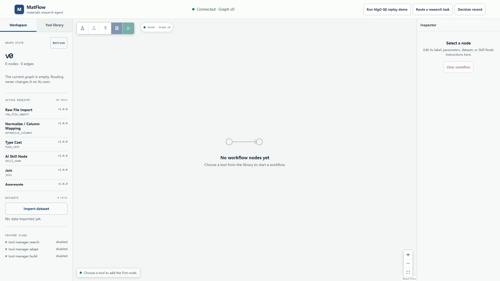
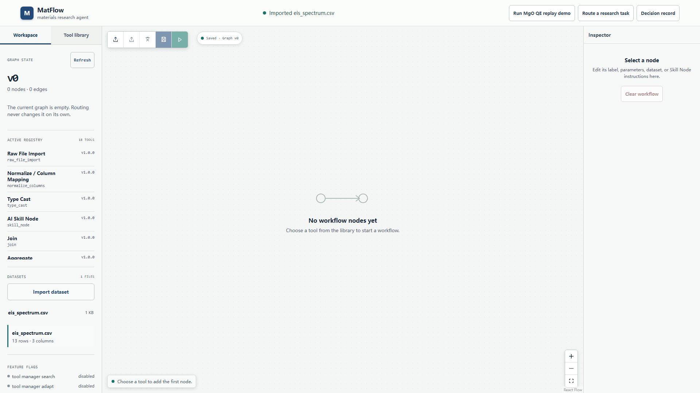
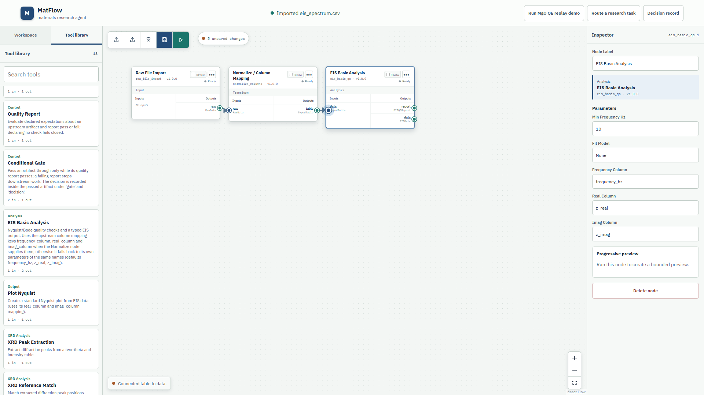
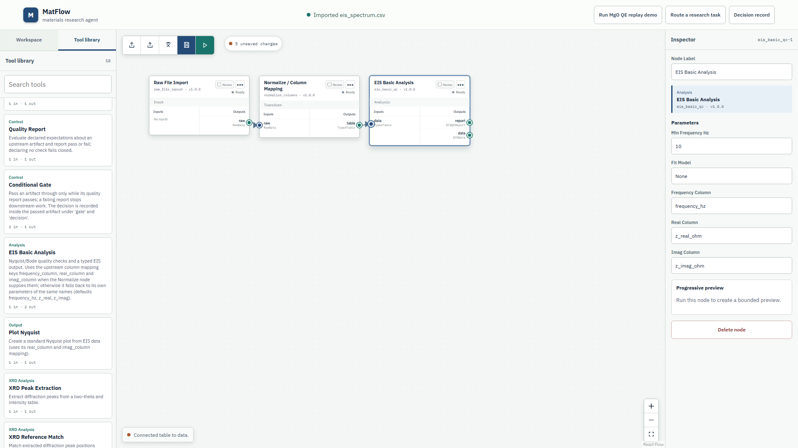
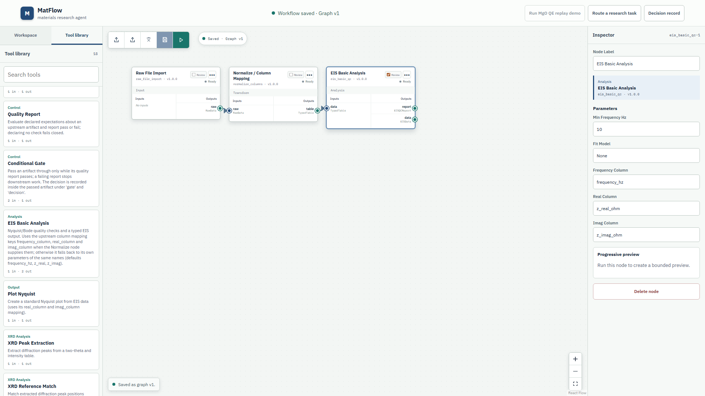
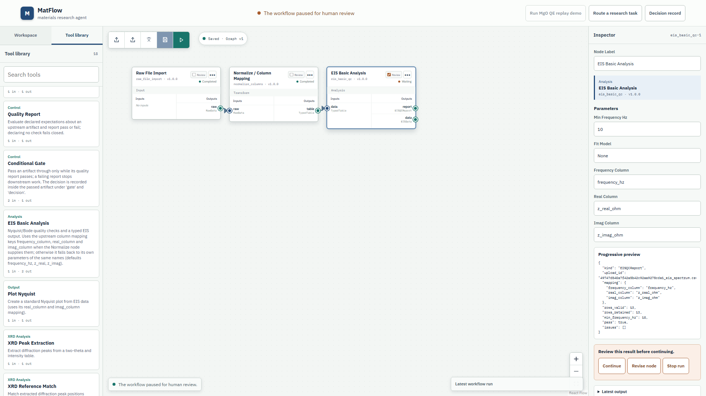
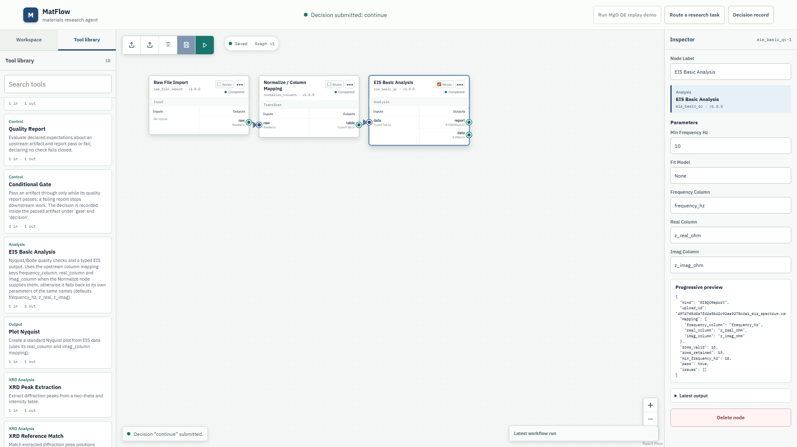
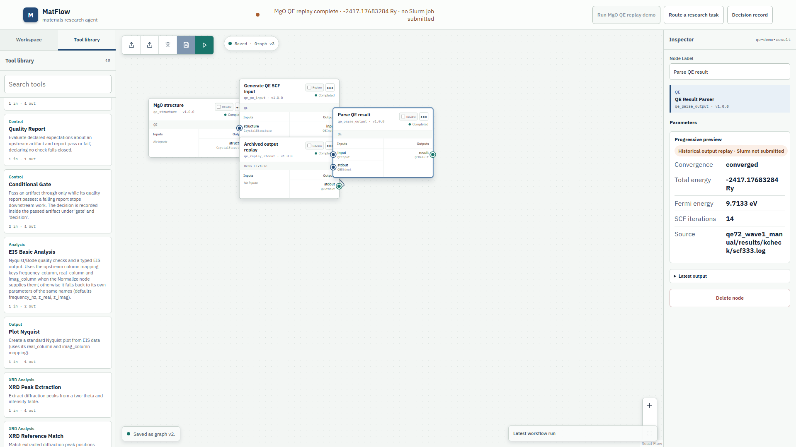
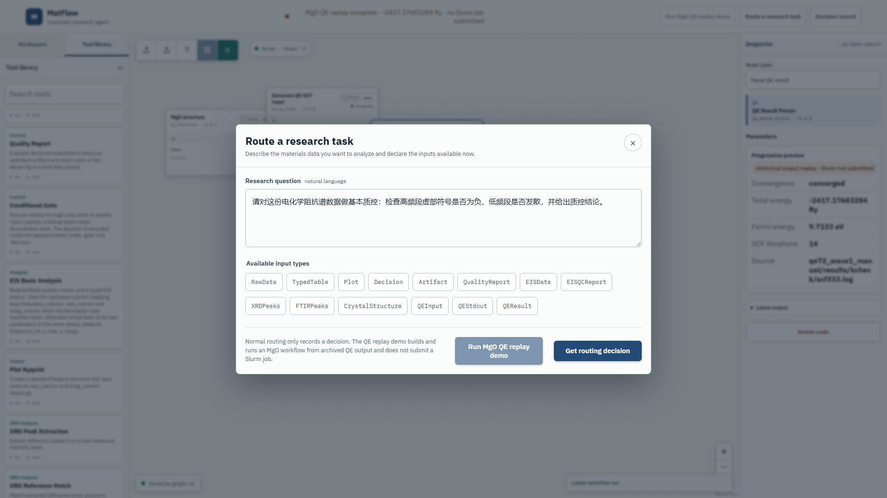
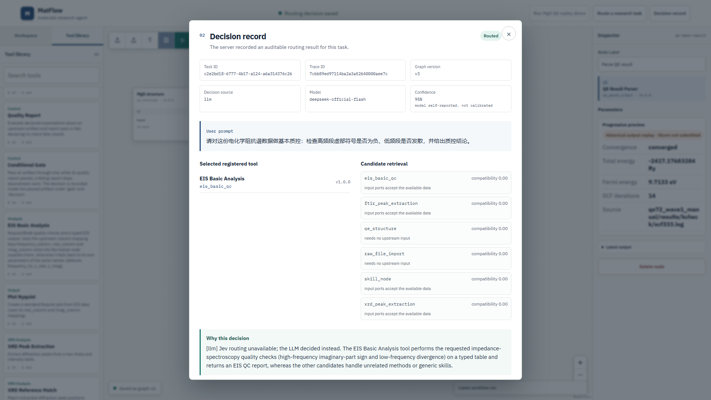

# MatFlow Web UI 演示录制教程（2026-10-20 版）

这是一份**照着做就能录出演示视频**的逐步教程：从清空工作区、启动服务，到 10 个分镜里每一次点击、
屏幕上应该出现的原文、旁白说什么、录屏软件怎么设、录完怎么剪。

- 视频里演示的功能清单见 [§2](#2-演示功能清单哪些功能会被演示出来)（先看它，能决定视频讲什么）。
- 期望画面（1920×1080，本次实拍）：[`screenshots/`](screenshots/)，逐帧数值见 [`capture.json`](capture.json)。
- 纯操作步骤（不含录制/分镜）见 [操作手册](../OPERATOR_RUNBOOK.zhcn.md)；逐项验收证据见 [验证报告](../REPORT.zhcn.md)。

> 本教程里的所有界面文案、数值与截图都来自 2026-10-20 的真实运行，不是示意图。
> 录制环境：后端 `acceptance/2026-10-20-demo` 分支、前端 `88060b8`、Windows 11、Chromium 1920×1080。

---

## 目录

1. [成品建议与时间轴](#1-成品建议与时间轴)
2. [演示功能清单（哪些功能会被演示出来）](#2-演示功能清单哪些功能会被演示出来)
3. [录制前准备](#3-录制前准备)
4. [分镜脚本与旁白](#4-分镜脚本与旁白)
5. [逐步操作教程（每一个点击）](#5-逐步操作教程每一个点击)
6. [OBS 录制设置](#6-obs-录制设置)
7. [剪辑与交付](#7-剪辑与交付)
8. [失败与重来（最容易踩的 8 个坑）](#8-失败与重来最容易踩的-8-个坑)
9. [复跑、重置与清理](#9-复跑重置与清理)
10. [附录](#10-附录)

> **最快路径**：① 按 [§3.2](#32-启动一套干净的演示环境开录前做) 启动干净环境 → ② 按 [§6.1](#61-一次性设置) 配好 OBS
> → ③ 按 [§5](#5-逐步操作教程每一个点击) 的 S0–S10 逐段录。功能清单看 [§2](#2-演示功能清单哪些功能会被演示出来)。

---

## 1. 成品建议与时间轴

**建议成品**：10 分钟左右（正片 8–12 分钟），1920×1080 / 30 fps / H.264 mp4，中文旁白或中文字幕。
结构是“一条主线 + 三个加演”：

| 段落 | 内容 | 建议时长 | 必录 |
|---|---|---|---|
| S0 开场 | 空工作台全景：工作区、工具库、18 个工具、领域包 | 0:40 | ✅ |
| S1 导入数据 | 导入 EIS CSV，数据集检视 13 行 × 3 列 | 0:30 | ✅ |
| S2 组图 | 添加 3 个节点、类型化端口连线 | 1:30 | ✅ |
| S3 参数与审核 | Inspector 改 3 个列名参数、打开 Review、保存 Graph v1 | 1:00 | ✅ |
| S4 运行到暂停 | Run → 审核门 Waiting，顶栏 paused | 0:40 | ✅ |
| S5 继续与结果 | Continue → Completed，读 `EISQCReport`：13/13、pass=true | 1:20 | ✅ |
| S6 停止分支 | Normalize 开 Review 重跑，Stop run 证明下游不执行 | 0:50 | 建议 |
| S7 导出/导入 | 导出工作流 JSON、删节点再导入恢复 | 0:40 | 可选 |
| S8 QE 历史回放 | 清空 → 一键 MgO QE 回放，`-2417.17683284 Ry` | 1:30 | ✅ |
| S9 中文路由与决策记录 | 中文研究问题 → 决策记录（来源/模型/置信度/候选/理由） | 1:30 | ✅ |
| S10 收尾 | 注册表、feature flags、API docs、窄屏 | 0:40 | 可选 |

**精简版（3–4 分钟）**：S0 压缩到 15 秒，只录 S1 → S2 → S3 → S4 → S5，结尾加 10 秒 S8 的 QE 回放。

**顺序按叙事走即可**，不用再担心互相影响：旧版本里 S9 的路由问题会被 QE 演示复用、先路由后 QE 会 422，
该问题已修复（前端 `88060b8`），现在 QE 演示始终使用固定的 MgO/SCF 提示词。

---

## 2. 演示功能清单（哪些功能会被演示出来）

### 2.1 主线：一条可操作、可审计、可复现的材料数据工作流

| 编号 | 演示的功能 | 出现在 | 观众在第几帧看到 | 证明什么 |
|---|---|---|---|---|
| F01 | 后端连通与图版本 | S0 | 顶栏 `Connected · Graph v0`；左侧 `Graph state` `v0 / 0 nodes · 0 edges` | WebUI 与真实后端会话建立 |
| F02 | 工具注册表（18 个工具、5 个领域包） | S0、S2、S10 | `Active registry 18 tools`；Tool library 卡片带 `v1.0.0` 与 `N in · M out` | 工具是注册表驱动的，不是写死的页面 |
| F03 | 数据导入与检视 | S1 | `Imported eis_spectrum.csv`；`eis_spectrum.csv`、`13 rows · 3 columns` | 真实文件上传、解析、列推断 |
| F04 | 工具库搜索与添加节点 | S2 | 点卡片 → 画布出现节点并自动选中 | 图由工具定义动态生成 |
| F05 | 类型化端口与连线 | S2 | 端口显示 `raw / RawData`（导入输出、Normalize 输入）、`table / TypedTable`（Normalize 输出）、`data / TypedTable`（EIS 输入）、`report / EISQCReport`；连成 2 条边 | 连接受数据类型约束（不是任意连线） |
| F06 | 节点与连线编辑 | S2、S7 | `•••` 菜单：Rename node / Review after run / Delete node；Inspector `Delete node`；**点连线选中（变粗）后按 Delete 只断开这一条** | 图可编辑、可重命名可删除；连错能拆掉一条线而不动节点 |
| F07 | Inspector 参数编辑 | S3 | `Frequency Column=frequency_hz`、`Real Column=z_real_ohm`、`Imag Column=z_imag_ohm` | 参数在界面上可改并持久化到服务端 |
| F08 | 人工审核门（Human-in-the-loop） | S3、S4、S6 | 节点头部 `Review` 勾选 → 运行时 `Waiting`；顶栏 `The workflow paused for human review`；`Continue / Revise node / Stop run` | 高风险步骤默认停下来等人确认 |
| F09 | 真实执行与结果 | S5 | `Completed`；`EISQCReport`：`rows_valid=13`、`rows_retained=13`、`min_frequency_hz=10`、`pass=true`、`issues=[]` | 不是 mock：结果来自真实计算 |
| F10 | 版本化保存与未保存变更 | S3、S7 | 画布 `Saved · Graph v1`；改动后 `2 unsaved changes`；保存提示 `Saved as graph v1.` | 每次保存是一个可追溯版本 |
| F11 | 工作流 JSON 导出 / 导入 | S7 | 导出 `local-default.matflow.json`；导入后 `Imported … Review and save to apply it.` | 工作流可带走、可复现 |
| F12 | 停止分支不执行下游 | S6 | Normalize=`Waiting` 时 EIS 仍 `Ready`、无输出；Stop run 后 Normalize=`Stopped`，EIS 仍未执行 | 人工拒绝 = 真停止，不是"跳过提示" |
| F13 | 中文自然语言路由 | S9 | `Route a research task` → 中文 `Research question` + 14 个输入类型 → 选中 `eis_basic_qc` | 中文请求由真实 LLM 路由（`Decision source=llm`） |
| F14 | 可审计决策记录 | S9 | `Decision record`：Task ID / Trace ID / Graph version / Decision source / Model / Confidence / 候选与理由 / 是否需人工确认 | 每个决策可回查，不是黑盒 |
| F15 | QE 历史回放（无 Slurm） | S8 | 4 节点 QE 图全部 Completed；`-2417.17683284 Ry`；`Historical output replay · Slurm not submitted` | 真实 QE 输出可回放，且**不伪装成新算的** |
| F16 | 前置条件守卫 | S8 | 工作区非空时顶栏两个 QE 按钮置灰，`title` 提示先清空 | 危险操作的界面护栏 |
| F17 | 领域包可插拔 | S0、S10 | 注册表里 EIS / XRD / FTIR / QE / Demo Fixture 分类并列 | 平台化而不是单点脚本 |
| F18 | 窄屏可用 | S10 | 1280×720 无横向滚动，顶栏按钮仍可见 | 屏幕小也能用 |

### 2.2 明确**不**演示的内容（避免误解和翻车）

| 不演示 | 原因 |
|---|---|
| 真实提交 QE/Slurm 计算 | 本机没有 Slurm；QE 演示是**历史输出回放**，界面已明确标注 |
| `Modify with AI` 让 LLM 生成节点 | 该路径未纳入本轮验收，现场可能不稳定 |
| 按住端口拖拽连线 | 本轮验收用的是“点输出端口 → 点输入端口”，拖拽路径未纳入验收；录制保持点选方式 |
| 多用户并发 / Ubuntu / Firefox、Safari | 本轮未验收，不能宣称 |
| 实验室真实数据 | 用仓库自带示例数据 `examples/data/01_eis_basic_qc/eis_spectrum.csv`，讲解时说明是示例 |
| 后端终端、启动日志 | 终端画面不进入视频，服务在开录前已启动好 |

---

## 3. 录制前准备

### 3.1 一次性准备

| 项 | 要求 |
|---|---|
| 屏幕 / 分辨率 | 1920×1080 或更高；显示缩放 100%（125% 会让画布变窄，Inspector 会掉到画布下方） |
| 浏览器 | Chrome / Edge，窗口最大化，**缩放 100%**（`Ctrl+0`），隐藏书签栏（`Ctrl+Shift+B`），关闭 DevTools 与其他标签页 |
| 录屏 | OBS Studio（推荐）或 Windows 自带 `Win+Alt+R`；详见 [§6](#6-obs-录制设置) |
| 鼠标可见性 | 安装 PowerToys 并开启 **Mouse Highlighter**（`Win+Shift+H`），点击时有一圈高亮，观众能跟住操作 |
| 通知 | 打开“专注助手/勿扰”，关闭微信/邮件/系统通知，避免录制中途弹窗 |
| 麦克风 | 旁白建议**录完再配**（见 [§7](#7-剪辑与交付)）；如果现场配，先试录 10 秒听底噪 |
| 数据文件 | 记住路径：`examples\data\01_eis_basic_qc\eis_spectrum.csv`（列：`frequency_hz,z_real_ohm,z_imag_ohm`，13 行） |

### 3.2 启动一套“干净”的演示环境（开录前做）

干净 = 空工作区 + 没有已导入的数据集。用**独立存档名**，不污染你平时用的 `default` 存档：

```powershell
# 在仓库根目录（下称 <repo>，例如你自己的 checkout 路径）
$env:MATFLOW_SAVE = 'demo-video'                          # 独立存档：data\saves\demo-video
$env:MATFLOW_LLM_CONFIG = 'config\llm-deepseek.json'      # 路由换 DeepSeek 官方 flash：实测 3.5 s/次
pwsh -File scripts\start_demo.ps1
```

期望输出（实测）：

```text
MatFlow live demo
[0/4] credentials from the User environment scope (values are never printed)
  SJTU key: yes | gateway caller key: yes | DeepSeek exclusive key: yes
[1/4] SJTU model gateway
  reusing the gateway already listening on 4078
[2/4] DeepSeek official gateway
  reusing the gateway already listening on 4080
[3/4] MatFlow backend
  started backend (pid <pid>)
  backend ready: http://127.0.0.1:8000/api/capabilities
[4/4] WebUI dev server
  WebUI ready: http://127.0.0.1:5173

MatFlow live demo is up:
  WebUI      http://127.0.0.1:5173
  API        http://127.0.0.1:8000/api
  API docs   http://127.0.0.1:8000/docs
```

然后打开 `http://127.0.0.1:5173/`。**这个终端窗口保持运行**，录制时不要出现在画面里
（把它最小化，或放到第二块屏）。

要点与替代方案：

- 不设 `MATFLOW_SAVE` 就落到默认存档 `data\saves\default`，可能已有旧的图和数据集，第一帧就不是空工作台。
- 若你的机器上 8000/5173 已被占用，先停掉旧栈再启动；**不要**只改前端端口而让 launcher 复用旧后端
  （旧后端不知道新前端的 CORS 来源）。
- 没有 DeepSeek 官方 key（`DEEPSEEK_API_KEY_MATFLOW_EXCLUSIVE`）时去掉 `MATFLOW_LLM_CONFIG`：
  路由走 SJTU `deepseek-chat`，本机实测单次 4–35 s，也能录，但等待镜头要剪掉或加速。
- 想检查密钥是否就绪（只打印 true/false，不打印值）：

```powershell
'SJTU_ZHIYUAN_API_KEY','LITELLM_DEFAULT_API_KEY','DEEPSEEK_API_KEY_MATFLOW_EXCLUSIVE' |
  ForEach-Object { '{0}: {1}' -f $_, [bool][Environment]::GetEnvironmentVariable($_,'User') }
```

### 3.3 开录前 60 秒检查（务必逐条过）

```powershell
# 1) 图是空的：期望 v0 · 0 nodes · 0 edges
Invoke-RestMethod http://127.0.0.1:8000/api/state |
  ForEach-Object { "v$($_.state.version) · $($_.state.nodes.Count) nodes · $($_.state.edges.Count) edges" }

# 2) 没有已导入的数据集：期望 0
Invoke-RestMethod http://127.0.0.1:8000/api/uploads |
  ForEach-Object { "$($_.files.Count) datasets" }
```

页面上的对照（见 [`screenshots/00-empty-workspace.png`](screenshots/00-empty-workspace.png)）：

- [ ] 顶栏状态条 `Connected · Graph v0`（不是 `Reading the MatFlow control plane…`）
- [ ] 左侧 `Graph state` `v0`、`0 nodes · 0 edges`、`The current graph is empty. Routing never changes it on its own.`
- [ ] `Active registry 18 tools`；`Datasets 0 files`、`No data imported yet.`
- [ ] 画布 `No workflow nodes yet`
- [ ] 顶栏三个按钮可见：`Run MgO QE replay demo`、`Route a research task`、`Decision record`
- [ ] 浏览器缩放 100%，书签栏隐藏，DevTools 关闭
- [ ] OBS 预览里画面完整、没有黑边/黑屏，鼠标高亮开着
- [ ] 手机静音、通知静音



### 3.4 先空跑一遍（不录）

建议先不录，按 §5 走完 S1–S5 一次，确认：端口连线成功、审核门出现、Continue 后数值是
`rows_valid=13 / pass=true`。然后把工作区重置（[§9](#9-复跑重置与清理)），再正式开录。
这样能避免“录到一半发现状态不对”重来。

### 3.5 开录前跑一遍自动健康自检（推荐，约 40 秒）

```powershell
# 前置：干净栈（同 §3.2），另开一个终端执行
node scripts\live_acceptance\check_demo_ui.mjs
# 期望末行：summary: {"PASS":60}；退出码 0
```

它按本教程 S0–S10 的顺序真实操作一遍界面并核对服务端状态（修复后复跑实测 **60 PASS / 0 FAIL /
0 KNOWN**，页面异常 0）。**注意：它会改动工作区**，请用独立存档（如 `demo-health`），或者录完再跑；
细节与残留限制见[健康检查报告](HEALTH_CHECK.zhcn.md)。

---

## 4. 分镜脚本与旁白

每一镜的“操作 → 期望画面 → 旁白”与 §5 的步骤一一对应。旁白逐字稿也放在
[附录 B](#附录-b旁白逐字稿可直接念)，可直接照念或改口语。

| 镜 | 起始 | 时长 | 画面 | 操作要点 | 旁白主题 |
|---|---|---|---|---|---|
| S0 | 0:00 | 40s | 空工作台全景 | 鼠标缓慢划过左栏、画布、顶栏 | 这是什么：材料研究工作台；左栏是工作区/注册表/数据集；画布是工作流 |
| S1 | 0:40 | 30s | 数据集出现 | `Import dataset` 选 CSV | 数据进来就能看到行列，不用写代码 |
| S2 | 1:10 | 90s | 三节点两边 | 依次点 3 张工具卡；点端口连线 | 每一步都是一个“工具”；端口有类型，连错类型连不上 |
| S3 | 2:40 | 60s | Inspector 参数、Review 勾选 | 改 3 个列名参数；勾 Review；点保存 | 参数在界面上改；审核开关决定哪里停下来 |
| S4 | 3:40 | 40s | `Waiting` + 审核门 | 点 Run（三角图标） | 到了审核点就停，下游不会偷跑 |
| S5 | 4:20 | 80s | `Completed` + 结果 JSON | 点 `Continue`；读预览 | 结果是真的：13 行全有效、质控通过 |
| S6 | 5:40 | 50s | 停止分支 | Normalize 开 Review → 运行 → `Stop run` | 人工拒绝时，下游确实没执行 |
| S7 | 6:30 | 40s | 导出/导入 | 导出 icon → 删节点 → 导入 | 工作流能带走、能复原 |
| S8 | 7:10 | 90s | QE 4 节点完成 | 清空 → 保存 → QE 按钮 | 真实 QE 输出回放；标注了不是新算的、没提交 Slurm |
| S9 | 8:40 | 90s | 决策记录面板 | 中文问题 + 勾 `TypedTable` → `Get routing decision` | 中文也能路由；每个决策有来源、模型、置信度、理由 |
| S10 | 10:10 | 40s | 注册表/flags/API docs | 轻微滚动展示 | 平台能力：18 工具、领域包、HTTP API |

---

## 5. 逐步操作教程（每一个点击）

> 约定：`点击` 指鼠标左键单击；按钮若只有图标，给出图标含义与 `title`/`aria-label`。
> 每一步都给出**期望画面**，和截图对不上就先停下来查 [§8](#8-失败与重来最容易踩的-8-个坑)。

### S0 开场：空工作台（0:00–0:40）

**操作**（只移动鼠标，不点击）：

1. 鼠标从左栏 `Graph state` 区域缓慢向下划到 `Active registry`、`Datasets`、`Feature flags`。
2. 移到画布中央 `No workflow nodes yet`。
3. 移到顶栏三个按钮（不要点）。

**期望画面**：见 [`screenshots/00-empty-workspace.png`](screenshots/00-empty-workspace.png)。

**旁白要点**：MatFlow 是材料数据的研究工作台；左边是“当前图 + 工具注册表 + 数据集 + 能力开关”；
中间画布是工作流；上面三个按钮分别是 QE 回放、路由、决策记录。工具注册表里有 18 个工具，分属
EIS、XRD、FTIR、QE 等分析包。

**注意**：`Feature flags` 三项当前都显示 `disabled`（工具管理器搜索/适配/构建未开放）。
镜头扫过没关系，不要在旁白里承诺它们可用。

---

### S1 导入数据（0:40–1:10）

**操作**：

1. 左栏 `Workspace` 页签 → `Datasets` → 点 **`Import dataset`**（它是一个样式成按钮的文件选择框）。
2. 在文件对话框里进入仓库的 `examples\data\01_eis_basic_qc\` 目录，选 `eis_spectrum.csv`。
   （提前把该文件放到手边，或用文件对话框地址栏粘贴完整路径，减少等待。）
3. 等待状态条变成 `Imported eis_spectrum.csv`。
4. 鼠标停在 `Datasets` 列表与下方详情上 2 秒。

**期望画面**：

- `Datasets` 出现 `eis_spectrum.csv`（约 1 KB）；
- 下方详情 `eis_spectrum.csv`、`13 rows · 3 columns`；
- 状态条 `Imported eis_spectrum.csv`。



**旁白要点**：上传的是示例 EIS 数据，13 行 3 列：频率、实部、虚部。平台会解析成表格并推断列，
下一步的工具就能直接消费它。

---

### S2 组图：加三个节点、连两条线（1:10–2:40）

**操作**：

1. 左栏切到 **`Tool library`** 页签（顶部 `Workspace | Tool library` 两个页签）。
2. 依次点击三张工具卡片（每次点击后画布会多一个节点并自动选中）：
   1. **`Raw File Import`**
   2. **`Normalize / Column Mapping`**
   3. **`EIS Basic Analysis`**
3. 选中 **Raw File Import**（若没自动选中就点它），在右侧 **Inspector** 的 `Parameters` 里把
   **`Dataset`** 下拉选成 `eis_spectrum.csv`（首项是 `Choose an imported dataset`，别选它）。
4. 连线（**点端口**，不需要拖拽）：
   1. 点 Raw File Import 右侧输出端口 **`raw`** → 画布底部出现提示
      `Select a compatible RawData input`（第二条连线时是 `Select a compatible TypedTable input`，带 `Cancel` 按钮）；
   2. 点 Normalize 左侧输入端口 **`raw`** → 生成第 1 条边；
   3. 点 Normalize 右侧输出端口 **`table`** → 再点 EIS 左侧输入端口 **`data`** → 第 2 条边。

**期望画面**：

- 画布 3 个节点、2 条边，节点之间是带箭头的连线；
- 节点标题下显示工具 id 与版本（如 `raw_file_import · v1.0.0`）；
- 端口上标着数据类型：`raw / RawData`、`table / TypedTable`、`data / TypedTable`、`report / EISQCReport`（EIS 还有一个输出 `data / EISData`）；
- 画布顶部版本块显示 `N unsaved changes`。



**旁白要点**：工作流就是“导入 → 列映射 → EIS 质检”三块。端口带类型：`raw` 是原始数据、
`table` 是规范化表格、`data` 是 EIS 数据（输入是 `TypedTable`，输出是 `EISQCReport`）；类型不匹配连不上，这是平台在防止接错线。

**常见卡点（现场真的会遇到）**：

- 点输出端口后**没出现** `Select a compatible … input` 提示，或点了输入端口**没生成边**：
  再点一次该输出端口，然后重新点输入端口即可（本次两次实拍都遇到过，重试就成功。
  这是已知缺陷 D-01，报告里有记录）。
- 连错了想取消：按 `Esc`，或点提示条里的 `Cancel`。
- 连错了想断开：**点那条连线**（选中后线会变粗）→ 按 `Delete`（或 `Backspace`）→ 左下提示
  `Connection removed from the draft.`，两端节点都保留（前端 `88060b8` 起可用）。
  如果两个节点挨得很近、连线很短，端口会把连线中点盖住导致点不中：先把节点拖开一点再点，
  或直接删节点重来。**注意**：Delete 删的是“当前选中的东西”——选中的是节点就会删节点，
  所以点连线后确认线变粗了再按。

---

### S3 参数、审核开关与保存（2:40–3:40）

**操作**：

1. 点击画布上的 **EIS Basic Analysis** 节点选中它。
2. 在右侧 Inspector 的 `Parameters` 区，把三个文本框改成列名（逐字输入）：
   - `Frequency Column` → `frequency_hz`
   - `Real Column` → `z_real_ohm`
   - `Imag Column` → `z_imag_ohm`
3. 点 EIS 节点标题栏右侧的 **`Review`** 复选框（`title="Pause after this node produces a preview"`）。
4. 点画布左上工具条里的 **保存** 图标（软盘，`aria-label="Save workflow"`）。
5. 鼠标停在画布顶部版本块，展示 `Saved · Graph v1`。

**期望画面**：

- 三个参数显示为 `frequency_hz` / `z_real_ohm` / `z_imag_ohm`；
- EIS 节点头部的 `Review` 打勾；
- 保存后状态条 `Workflow saved · Graph v1`，画布版本块 `Saved · Graph v1`，
  左下提示 `Saved as graph v1.`。





**旁白要点**：三个参数是列映射，告诉工具哪一列是频率/实部/虚部。然后把这个节点的审核开关打开：
运行到它时，工作流会停下来等我确认。保存后就是 `Graph v1` 这个可追溯版本。

**注意**：

- 保存按钮在“没有改动”时是灰的，这是正常的；只要改过参数或勾过 Review 就会亮。
- 输入框是即时生效的草稿，保存前只在画布草稿里；保存后才落到服务端。

---

### S4 运行到审核门（3:40–4:20）

**操作**：

1. 点画布左上工具条里的 **运行** 图标（三角，`aria-label="Run workflow from start"`）。
2. 观察三个节点状态：Raw File Import、Normalize 变 `Completed`，EIS 停在 **`Waiting`**。
3. 点击 EIS 节点（若未选中），把 Inspector 滚动到审核门区域。

**期望画面**：

- 顶栏状态条 `The workflow paused for human review`；
- EIS 节点状态 `Waiting`；
- Inspector 出现审核门：标题 `Review this result before continuing.`，三个按钮
  **`Continue` / `Revise node` / `Stop run`**。



**旁白要点**：跑起来了。前两个节点自动完成，到 EIS 质检这里停住 —— 因为开了审核开关。
这时下游的节点还是 `Ready`，没有执行。我可以继续、让 AI 改这个节点的参数，或者直接停掉整条运行。

**录制提示**：这个暂停状态可以多停 2–3 秒，方便观众看清“Waiting”和三个按钮。左下提示现在与顶栏一致，
也是 `The workflow paused for human review.`（D-07 已修复）。

---

### S5 继续并解读结果（4:20–5:40）

**操作**：

1. 在审核门点 **`Continue`**。
2. 等 EIS 节点变 **`Completed`**（其余两个保持 Completed）。
3. 把 Inspector 滚到 `Progressive preview`，鼠标沿 JSON 逐行指过去；需要时展开
   `Latest output` 看完整输出。
4. 关键行用鼠标高亮：`rows_valid`、`rows_retained`、`min_frequency_hz`、`pass`、`issues`。

**期望画面**：

- 顶栏 `Decision submitted: continue`（左下也提示 `Decision “continue” submitted.`）；
- EIS `Completed`，全部三个节点 Completed；
- 预览 JSON：

```json
{
  "kind": "EISQCReport",
  "mapping": { "frequency_column": "frequency_hz", "real_column": "z_real_ohm", "imag_column": "z_imag_ohm" },
  "rows_valid": 13,
  "rows_retained": 13,
  "min_frequency_hz": 10,
  "pass": true,
  "issues": []
}
```



**旁白要点**：点继续，工作流走完。结果是一个 `EISQCReport`：13 行全部有效、13 行全部保留、
最低频率 10 Hz、质控结论 `pass=true`、问题列表为空。这些数字来自真实执行，不是演示占位。

**录制提示**：本次实拍的数值都写在上面的 JSON 里；如果重跑，`upload_id` 会变（每次上传生成
新 id），其余数值应一致。旁白只念稳定的数值，不要念 `upload_id`。

---

### S6 停止分支（可选，建议录；5:40–6:30）

**目的**：证明“人工拒绝”会真的让下游不执行，而不是弹个提示继续跑。

**操作**：

1. 点 Normalize 节点，勾上它的 **`Review`**。
2. 点 **保存**（`Saved as graph v2`）。
3. 点 **运行**，等 Normalize 变 `Waiting`（EIS 仍是 `Ready`）。
4. 点 Normalize 节点选中它，在审核门点 **`Stop run`**。
5. 观察 Normalize 变 `Stopped`（界面状态文案；服务端是 `cancelled`），EIS 保持未执行。

**期望画面**：EIS 节点没有预览、没有输出；`Latest output` 为空。参考
[`../frontend-ops/screenshots/09-stop-run-waiting.png`](../frontend-ops/screenshots/09-stop-run-waiting.png)、
[`../frontend-ops/screenshots/09b-stop-run-branch.png`](../frontend-ops/screenshots/09b-stop-run-branch.png)。

**旁白要点**：这次我在更早的节点开审核，然后选择停止。下游的 EIS 一次都没执行，输出是空的。
人工说不，就是真的不。

**收尾**：录完这段把 Normalize 的 `Review` 取消并保存，避免影响后面的导出/导入镜头。

---

### S7 导出 / 导入工作流 JSON（可选；6:30–7:10）

**操作**：

1. 点画布左上 **导出** 图标（`aria-label="Export workflow JSON"`），浏览器下载
   `local-default.matflow.json`。
2. 点 Normalize 节点 → Inspector 底部 **`Delete node`**（画布 3→2，左下提示 `1 node removed from the draft.`）。
3. 点 **导入** 图标（`aria-label="Import workflow JSON"`），选刚下载的文件。
4. 期望：画布恢复 3 节点 2 边，提示 `Imported local-default.matflow.json. Review and save to apply it.`。

**期望画面**：[`../frontend-ops/screenshots/05-export-import.png`](../frontend-ops/screenshots/05-export-import.png)。

**旁白要点**：整个工作流可以导出成 JSON 带走，换台机器导入就能复原；参数和审核设置都在里面。

**注意**：如果导入的图和当前已保存的图完全一样，再点保存会提示 `The workflow is already saved.`
且不产生新版本 —— 这是预期行为（D5），判断导入是否生效看画布/服务端状态即可。

---

### S8 QE 历史回放（7:10–8:40）

> 前置条件：**工作区必须是空的**，否则 `/api/qe/demo` 返回 `409`，顶栏按钮也会置灰（F16）。

**操作**：

1. 点画布空白处取消选中 → Inspector 变成空态 → 点 **`Clear workflow`**（画布归零）。
2. 点 **保存**（`Saved as graph v2` 或下一个版本；此时服务端 0 节点 0 边）。
3. 点顶栏 **`Run MgO QE replay demo`**。
4. 等 ~1–3 秒，观察顶栏与画布。

**期望画面**：

- 顶栏：`MgO QE replay complete · -2417.17683284 Ry · no Slurm job submitted`；
- 画布 4 个节点：`MgO structure` → `Generate QE SCF input` → `Archived output replay` → `Parse QE result`，
  全部 `Completed`；
- 选中 `Parse QE result`，Inspector 预览带徽标 **`Historical output replay · Slurm not submitted`**，
  并显示：`Convergence converged`、`Total energy -2417.17683284 Ry`、`Fermi energy 9.7133 eV`、
  `SCF iterations 14`、`Source qe72_wave1_manual/results/kcheck/scf333.log`。



**旁白要点**：这是 QE 的端到端演示：从 MgO 结构、生成 SCF 输入、回放归档输出、解析结果四步。
注意这个徽标 —— 它明确写着这是历史输出回放、没有提交 Slurm，能量是归档里真实的结果
`-2417.17683284 Ry`，Fermi 能 9.7133 eV。我们不把它伪装成刚算出来的。

**录制提示**：在清空之前（S7 结束时）可以顺手展示一下：工作区非空时顶栏两个 QE 按钮是灰的，
鼠标悬停会提示 `The QE replay demo needs an empty workspace; clear the workflow first.`。这是界面护栏，值得 2 秒镜头。

---

### S9 中文路由与决策记录（8:40–10:10）

> 建议放在 S8 之后（叙事上先算后路由）。旧版 QE 演示会复用这里的路由问题、非 MgO 问题会 `422`；
> 该问题已修复（前端 `88060b8`，QE 使用固定 MgO/SCF 提示词），顺序不再受限。

**操作**：

1. 点顶栏 **`Route a research task`**，弹出对话框 `Route a research task`。
2. 在 `Research question` 文本域输入（可以直接粘贴）：

   ```text
   请对这份电化学阻抗谱数据做基本质控：检查高频段虚部符号是否为负、低频段是否发散，并给出质控结论。
   ```

3. 在 `Available input types` 里勾选 **`TypedTable`**（共 14 个复选项）。
4. 点右下 **`Get routing decision`**。等待期间按钮显示 `Routing…`（本次实测约 3.5 秒；
   若走默认 SJTU 模型可能 4–35 秒，剪辑时剪掉或加速）。
5. 决策对话框自动弹出 `Decision record`。

**期望画面**：

- 顶栏 `Routing decision saved`（若需要人工确认则是 `Routing is waiting for human confirmation`）；
- 对话框右上徽标 `Routed`（需要确认时是 `Confirmation required`）；
- 审计事实：`Task ID`、`Trace ID`、`Graph version v3`（按本教程顺序；加演 S6/S7 会不同）、**`Decision source llm`**、
  **`Model deepseek-official-flash`**、**`Confidence 95%`**（下方小字 `model self-reported, not calibrated`）；
- `User prompt` 显示刚输入的中文；
- `Selected registered tool`：`EIS Basic Analysis` / `eis_basic_qc` / `v1.0.0`；
- `Candidate retrieval`：候选工具及 `compatibility 0.00` 与入选理由；
- `Why this decision`：一段英文理由，开头是 `[llm] Jev routing unavailable; the LLM decided instead. …`；
- 底部 `Human review required` 或 `Error & handling` 说明。





**旁白要点**：我用中文提需求，平台没有用关键词匹配，而是真的让模型做路由，选中了 EIS 基础分析。
决策记录里能看到：这次是 LLM 决定的、用的哪个模型、模型自报的置信度（界面明确写了未校准）、
候选工具和入选理由、以及这次运行对应的图版本。每个决策都能回查。

**注意**：

- `Confidence` 每次略有不同（本次两次实拍是 95%、97%），旁白说“95% 左右”即可；
- 决策记录的模型是**服务端配置**决定的；录前设 `MATFLOW_LLM_CONFIG=config\llm-deepseek.json`
  才会是 `deepseek-official-flash`，否则显示 SJTU 的 `deepseek-chat`；
- 决策记录只存在当前页面会话里：**刷新页面后 `Decision record` 面板会变空**。不要录完这一段后刷新；
  如果误刷新，重新发一次任务即可（会生成新的 Task ID）。

---

### S10 收尾（可选；10:10–10:50）

**操作**：

1. 关闭对话框，把窗口缩到 1280×720（可选），展示无横向滚动、顶栏按钮仍可见。
2. 左栏回 `Workspace` 页签，缓慢滚动 `Active registry`，展示 `18 tools` 与各领域包。
3. 浏览器新标签打开 `http://127.0.0.1:8000/docs`，展示 FastAPI 接口文档（可选，2–3 秒）。
4. 回到工作台结束。

**期望画面**：[`../frontend-ops/screenshots/08-narrow-1280x720.png`](../frontend-ops/screenshots/08-narrow-1280x720.png)。

**旁白要点**：同一套能力也通过 HTTP API 暴露，前端只是其中一个客户端；注册表里 18 个工具、
多个领域包可以并行演进。

---

## 6. OBS 录制设置

> 以下为 OBS Studio（Windows）实测可用的设置；版本不同菜单名可能略有差异。
> 不想装 OBS 也可以直接看 §6.3 的系统自带方案。

### 6.1 一次性设置

1. **画布**：`设置 → 视频` → 基础（画布）分辨率 `1920×1080`，输出（缩放）分辨率 `1920×1080`，
   FPS `30`。
2. **输出**：`设置 → 输出 → 输出模式：简单` → 录像质量 `高质量`，录像格式 **`mp4`**
   （想更抗中断可选 `mkv`，剪完再转 mp4），编码器 `x264`（或你的 N 卡 `NVENC`），
   码率 `6000–8000 Kbps`。
3. **音频**：`设置 → 音频` → 采样率 `48 kHz`；麦克风选你的麦；如果现场配旁白，
   把麦克风轨道打开；不现场配就静音，后期配音。
4. **来源**：`+ → 窗口捕获` → 选 `[chrome.exe] MatFlow — Google Chrome`（或你的浏览器窗口）。
   - 若窗口捕获**黑屏**：先关掉 Chrome 的硬件加速（`chrome://settings/system` → 关闭“使用图形加速”），
     重启浏览器；或改用 `显示器捕获` + `Alt` 裁剪。
5. **缩放**：选中来源 → 右键 `变换 → 适配屏幕`（或 `缩放到屏幕大小`），保证画面铺满 1920×1080。
   Chrome 最大化时内容区约 1920×950，上下会有细黑边；剪的时候裁掉即可。
6. **快捷键**：`设置 → 热键` → 给“开始录制 / 停止录制 / 暂停录制”设快捷键（例如 `F9` / `F10`）。
7. （可选）开启鼠标高亮：用 PowerToys 的 **Mouse Highlighter**（`Win+Shift+H`），比 OBS 插件简单。
8. 先**试录 15 秒**，回放检查：字是否清楚、鼠标是否跟得住、有没有黑屏/掉帧/杂音。

### 6.2 录制时的操作节奏

- 每个动作之间停 0.5–1 秒，让观众看清状态变化；点击前把鼠标停在目标上 0.3 秒再点。
- 输入参数时不要用 `Ctrl+A` 一把替换（观众看不清），逐字输入或至少慢速粘贴。
- 旁白如果现场配：说“现在点保存”之前先点，点完再说，避免声音盖住界面反馈。
- 状态变化（如 `Waiting`）出现后停 2 秒再旁白。
- 中途失败：**不要删**，按 `F10` 暂停，记下失败点，继续往下录；后期决定重录哪一段。

### 6.3 不装 OBS 的替代方案

| 方案 | 命令/操作 | 说明 |
|---|---|---|
| Windows 游戏栏 | `Win+Alt+R` 开始/停止；`Win+G` 打开设置 | 录当前窗口，能带麦克风；适合 5 分钟以内 |
| 截图工具（Win11） | `Win+Shift+S` → 录像按钮 → 选区域 | 可录区域+麦克风，简单但功能少 |
| PowerPoint | 插入 → 屏幕录制 | 可录区域，导出 mp4，适合简单剪辑 |

---

## 7. 剪辑与交付

### 7.1 必剪的三类片段

1. **等待**：路由（3.5 s 或更久）、QE 回放（1–3 s）、页面首次加载。
   处理：剪掉中间，或做 4×–8× 加速并标注“加速播放”。
2. **失误**：端口没连上、点错参数等。剪掉后从“重试成功”处接上；如确实想保留“重试”的真实感，
   加字幕 `端口点击偶发不生效，重试一次`。
3. **开场/收尾的鼠标乱动**：保留空白 1–2 秒即可。

### 7.2 让视频更好懂的四件事

1. **字幕**：中文旁白配中文字幕；关键数值（`rows_valid=13`、`pass=true`、`-2417.17683284 Ry`）
   用字幕强调一次。
2. **章节**：按 §4 的分镜加章节/分 P，标题用“导入数据 / 组图 / 人工审核 / 结果 / QE 回放 / 中文路由”。
3. **局部放大**：1080p 下侧栏文字偏小；在 Inspector 结果、决策记录面板处加 1.2–1.5 倍放大镜头。
4. **封面**：一帧 `06-completed-result.png` 或 `10-decision-record.png` + 标题
   “MatFlow：可审核的材料数据工作流”。

### 7.3 导出与命名

- 导出：H.264 / 1920×1080 / 30 fps / AAC 192 kbps；文件名
  `matflow-demo-YYYY-MM-DD.mp4`（例如 `matflow-demo-2026-10-20.mp4`）。
- 在上传平台的简介里贴时间轴（可直接用 §4 的表格）和仓库链接：
  - 后端：https://github.com/Syanz7755/matflow/tree/acceptance/2026-10-20-demo
  - 前端：https://github.com/Syanz7755/matflow-frontend
- 如果视频要对外发布，**保留** QE 的“历史回放”说明与已知缺陷说明（演示里不要说“全部完成/完美”）。

---

## 8. 失败与重来（最容易踩的 8 个坑）

| # | 现象 | 原因 | 处置 |
|---|---|---|---|
| 1 | 点输出端口后没出现 `Select a compatible … input`；或点了输入端口没生成边 | 端口点击偶发未注册（D-01） | 再点一次输出端口 → 再点输入端口；或按住拖拽。实在不行删节点重来。**录制时慢一点** |
| 2 | 点连线没反应、删不掉 | 节点挨得太近时连线太短，中点被端口盖住（不是删除逻辑问题） | 先把节点拖开再点连线；选中（变粗）后按 Delete 只删这一条。旧版完全不能删，`88060b8` 起已修复 |
| 3 | 页面一直显示 `Reading the MatFlow control plane…` | CORS：后端允许来源不含当前前端端口；或 `VITE_MATFLOW_API_URL` 不对/后端没起 | 用 `scripts\start_demo.ps1` 启动（它会带 CORS）；自定义端口时前后端端口要一起改并设 `MATFLOW_CORS_ORIGINS` |
| 4 | 点 `Run MgO QE replay demo` 后状态条报 `409` / `demo_requires_empty_workspace` | 工作区非空 | 先 `Clear workflow` 再 **保存**，然后点 QE 按钮（按钮此时才会亮） |
| 5 | 点了 QE 按钮却 `422`，提示只支持 MgO/SCF | 旧版把路由对话框里的中文问题带进了 QE 演示（`88060b8` 前）；新版固定用 MgO/SCF 提示词 | 确认前端是 `88060b8` 之后的版本；旧版本按 §4 的顺序先录 QE、后录路由 |
| 6 | 路由按钮转很久（30 s+）或超时 | 用了默认 SJTU 模型/网络变慢 | 录前设 `MATFLOW_LLM_CONFIG=config\llm-deepseek.json`（实测 3.5 s）；或剪辑时剪掉等待 |
| 7 | 保存按钮是灰的 / 提示 `The workflow is already saved.` | 没有未保存改动；或导入的图与已保存图一致（D5，预期行为） | 正常现象；先改点东西再保存，或直接看画布/服务端状态确认 |
| 8 | 工作区状态乱了（旧图、旧数据集、版本号很怪） | 用了带旧状态的存档 | 重置：见 [§9](#9-复跑重置与清理)，删掉 `data\saves\demo-video` 重启 |

补充两条录制环境坑：

- **OBS 窗口捕获黑屏**：关闭 Chrome 硬件加速，或改用“显示器捕获”。
- **画面比例不对/有黑边**：OBS 来源右键 `变换 → 适配屏幕`；导出前在剪辑软件里裁掉 10–20 px。

---

## 9. 复跑、重置与清理

### 9.1 每录完一条，重置成空工作台

```powershell
# 1) 在启动器的终端按 Ctrl+C（它会清理自己启动的后端/前端；网关保持运行以便复用）
# 2) 删除录制用的存档（下次启动就是全新的空工作区）
Remove-Item -Recurse -Force data\saves\demo-video -ErrorAction SilentlyContinue
Remove-Item Env:MATFLOW_DATA_ROOT -ErrorAction SilentlyContinue   # 若之前设过
# 3) 重新启动（同 §3.2）
$env:MATFLOW_SAVE = 'demo-video'
$env:MATFLOW_LLM_CONFIG = 'config\llm-deepseek.json'
pwsh -File scripts\start_demo.ps1
```

**确认已重置**：

```powershell
Invoke-RestMethod http://127.0.0.1:8000/api/state |
  ForEach-Object { "v$($_.state.version) · $($_.state.nodes.Count) nodes · $($_.state.edges.Count) edges" }
Invoke-RestMethod http://127.0.0.1:8000/api/uploads | ForEach-Object { "$($_.files.Count) datasets" }
# 期望：v0 · 0 nodes · 0 edges；0 datasets
```

### 9.2 录完之后的清理

```powershell
# 停掉演示栈（Ctrl+C 启动器即可）；若端口还在：
Get-NetTCPConnection -LocalPort 8000,5173 -State Listen -ErrorAction SilentlyContinue |
  ForEach-Object { Stop-Process -Id $_.OwningProcess -Force }
# 删除录制存档（不想要录制用的图/上传时）
Remove-Item -Recurse -Force data\saves\demo-video -ErrorAction SilentlyContinue
```

模型网关（4078/4080）可以保留运行，下次 `start_demo.ps1` 会直接复用。

### 9.3 可选：自动生成“期望画面”并核对

仓库里有一个不改仓库的脚本，用 Playwright 走完 §5 的 S0–S9 并截取 11 张 1920×1080 画面，
同时把旁白要念的数值写进 `capture.json`。它**不是**录屏，但可以在录前确认演示机器表现正确：

```powershell
# 前置：后端 + WebUI 已启动（§3.2），工作区为空
node scripts\live_acceptance\capture_demo_frames.mjs
# 默认输出到 docs\acceptance\2026-10-20-live\demo-tutorial\screenshots\
# 自定义：$env:MATFLOW_WEB_URL / MATFLOW_API / MATFLOW_FRAME_OUT / MATFLOW_VIEWPORT
```

如果要核对“后端真的能跑通整条链路”，另有一个纯 API 断言脚本（它会写工作区，建议在
**另一个存档**上跑，不要和录制环境共用）：

```powershell
$env:MATFLOW_SAVE = 'api-check'
.\.venv\Scripts\python.exe scripts\live_acceptance\check_workflow_api.py
```

---

## 10. 附录

### 附录 A：命令速查

```powershell
# 启动演示栈（干净存档 + 快模型）
$env:MATFLOW_SAVE = 'demo-video'
$env:MATFLOW_LLM_CONFIG = 'config\llm-deepseek.json'
pwsh -File scripts\start_demo.ps1

# 打开 WebUI
Start-Process 'http://127.0.0.1:5173/'

# 状态检查
Invoke-RestMethod http://127.0.0.1:8000/api/state | ConvertTo-Json -Depth 6

# 生成期望画面 + 数值
node scripts\live_acceptance\capture_demo_frames.mjs

# 端到端 API 断言（另用存档）
$env:MATFLOW_SAVE = 'api-check'
.\.venv\Scripts\python.exe scripts\live_acceptance\check_workflow_api.py

# 重置录制存档
Remove-Item -Recurse -Force data\saves\demo-video -ErrorAction SilentlyContinue
```

### 附录 B：旁白逐字稿（可直接念）

> 按 §4 顺序；可自由改口语。方括号是操作提示，不是台词。

**S0 开场**
> 这是 MatFlow，一个面向材料数据的研究工作台。左边是当前工作流的状态、工具注册表和数据集；
> 中间是工作流画布；右边是选中节点的检查器。工具注册表里有 18 个工具，覆盖 EIS、XRD、FTIR、
> 量子化学计算等领域。今天我用一条 EIS 数据质检的工作流，演示从导入、组图、人工审核到结果复盘的完整过程。

**S1 导入**
> 先导入数据。这是一份示例电化学阻抗谱，13 行 3 列：频率、实部、虚部。平台自动解析出行列，
> 后面的工具可以直接使用。

**S2 组图**
> 工作流三步：导入原始文件、列映射规范化、EIS 基础分析。每张卡片就是一个真实工具。
> 端口是有类型的：原始数据、表格、EIS 数据。类型对不上连不起来，这一步平台在帮我防错。

**S3 参数与审核**
> 在检查器里把三个列名参数设为频率、实部、虚部对应的列。然后打开这个节点的审核开关：
> 运行到它时工作流会停下来等我确认。保存成 Graph v1。

**S4 运行到审核**
> 点运行。前两个节点自动完成，到 EIS 质检这里停住了，状态是 Waiting，下游还没有执行。

**S5 继续与结果**
> 点继续。工作流执行完成。结果是 EIS 质控报告：13 行全部有效、13 行全部保留、最低频率 10 Hz、
> 结论 pass=true、没有发现问题。这些数字是真实计算出来的。

**S6 停止分支（如录）**
> 再演示一次拒绝：我在更早的节点开审核，这次选择停止。可以看到下游的 EIS 一次都没有执行，
> 输出是空的。人工说不，就是真的不执行。

**S7 导出导入（如录）**
> 工作流可以导出成 JSON，换台机器导入就能复原，参数和审核设置都保留。

**S8 QE 回放**
> 这是 QE 的端到端演示：MgO 结构、生成 SCF 输入、回放归档输出、解析结果。请注意这个徽标：
> 它是历史输出回放，没有提交 Slurm。能量 -2417.17683284 Ry 和 Fermi 能 9.7133 eV 来自归档的
> 真实 QE 输出，我们不把它说成是新算的。

**S9 中文路由**
> 现在用中文提一个需求：对这份阻抗谱做基本质控。平台没有用关键词匹配，而是让模型来路由，
> 选中了 EIS 基础分析工具。决策记录里可以看到：这次由 LLM 决定、用的哪个模型、模型自报的
> 置信度（界面注明未校准）、候选工具、以及入选理由。每个决策都能回查。

**S10 收尾**
> 同一套能力也通过 HTTP API 暴露，前端只是其中一个客户端。工具、领域包和审核策略都可以
> 独立演进。

### 附录 C：证据索引

| 内容 | 位置 |
|---|---|
| 本教程的期望画面（1920×1080，11 张） | [`screenshots/`](screenshots/) |
| 逐帧实测数值（数据集、结果 JSON、QE 数值、路由耗时/模型/置信度、页面错误数） | [`capture.json`](capture.json) |
| 同一流程的纯操作手册（无分镜/录制内容） | [`../OPERATOR_RUNBOOK.zhcn.md`](../OPERATOR_RUNBOOK.zhcn.md) |
| 前端操作逐项验收（17 PASS / 1 FAIL）与缺陷清单 | [`../frontend-ops/FRONTEND_OPS.zhcn.md`](../frontend-ops/FRONTEND_OPS.zhcn.md) |
| Lead 独立实例复验 | [`../lead-verify/LEAD_VERIFY.zhcn.md`](../lead-verify/LEAD_VERIFY.zhcn.md) |
| 本轮总报告（中文路由、多模型矩阵、缺陷） | [`../REPORT.zhcn.md`](../REPORT.zhcn.md) |
| 录制顺序健康自检（60 PASS / 0 FAIL / 0 KNOWN） | [`HEALTH_CHECK.zhcn.md`](HEALTH_CHECK.zhcn.md)、[`health-check.json`](health-check.json) |
| 健康自检脚本 | [`../../../../scripts/live_acceptance/check_demo_ui.mjs`](../../../../scripts/live_acceptance/check_demo_ui.mjs) |
| 期望画面生成脚本 | [`../../../../scripts/live_acceptance/capture_demo_frames.mjs`](../../../../scripts/live_acceptance/capture_demo_frames.mjs) |
| 端到端 API 断言脚本 | [`../../../../scripts/live_acceptance/check_workflow_api.py`](../../../../scripts/live_acceptance/check_workflow_api.py) |

### 附录 D：截图清单

| 文件 | 画面 | 出现在 |
|---|---|---|
| `00-empty-workspace.png` | 空工作台：`Graph v0`、18 工具、0 数据集 | S0 |
| `01-import-dataset.png` | `eis_spectrum.csv`、13 rows · 3 columns | S1 |
| `02-graph-built.png` | 三节点两边，端口带类型 | S2 |
| `03-inspector-params.png` | 三个列名参数已改 | S3 |
| `04-saved-review-on.png` | Review 勾选 + `Saved · Graph v1` | S3 |
| `05-review-waiting.png` | `Waiting` + `Continue / Revise node / Stop run` | S4 |
| `06-completed-result.png` | `Completed` + `EISQCReport` 结果 | S5 |
| `07-cleared-workspace.png` | 清空后的空画布（QE 前置） | S8 |
| `08-qe-replay.png` | 4 节点 QE 回放 + `-2417.17683284 Ry` | S8 |
| `09-route-dialog.png` | 中文研究问题 + 14 个输入类型 | S9 |
| `10-decision-record.png` | 决策记录：来源/模型/置信度/候选/理由 | S9 |
